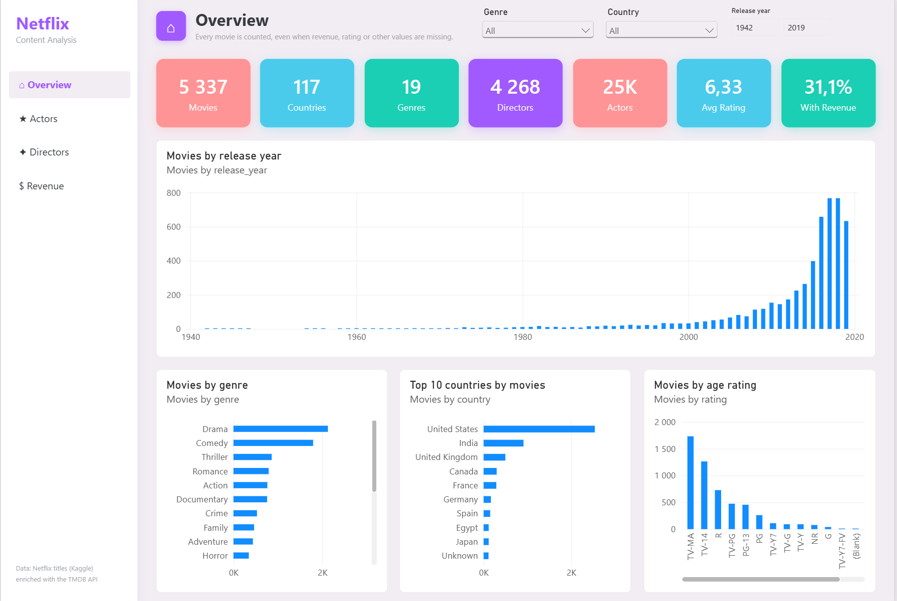
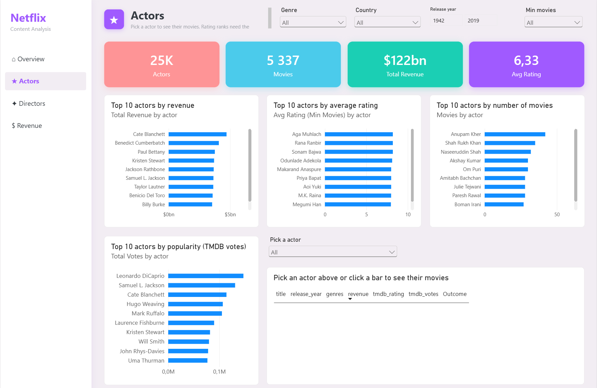
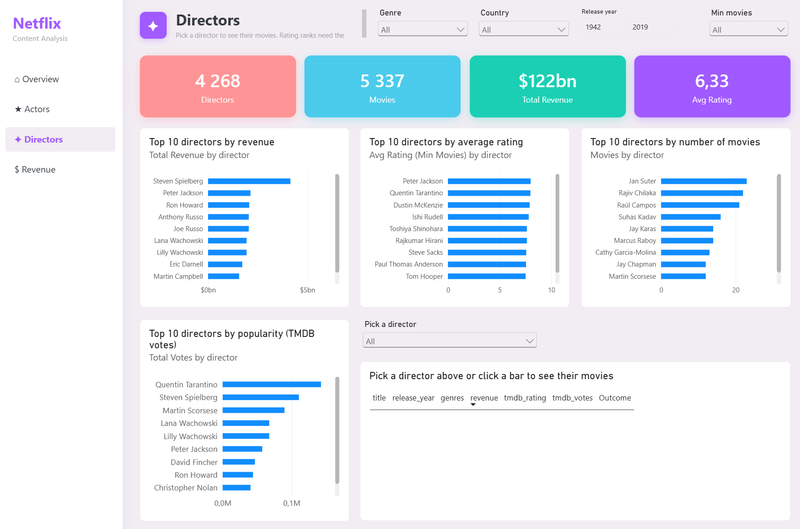
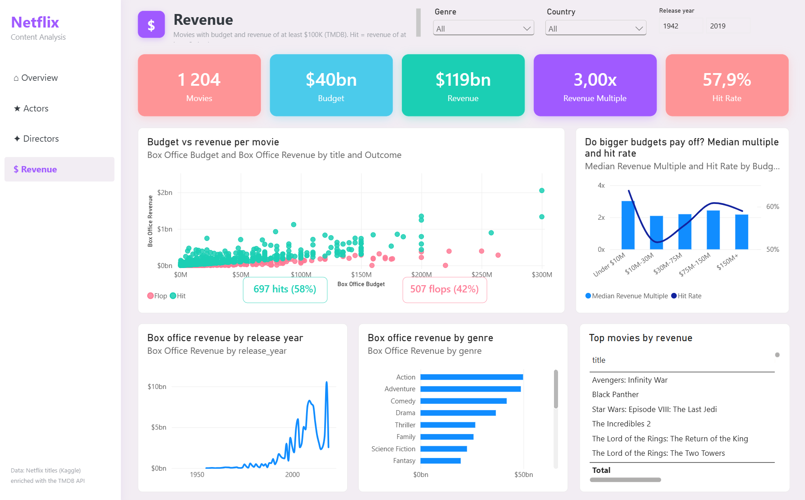

# Netflix Content Analysis

An end-to-end data analytics project on the Netflix catalogue: Python cleaning, TMDB API enrichment, PostgreSQL analysis with statistics, a Power BI dashboard, and a live experiment that predicts whether upcoming movies will be hits.

## Questions
| Question | Answered in |
|---|---|
| How much content is added each year, movies vs TV shows? | Power BI dashboard |
| Which countries, genres, actors and directors perform best? | Power BI dashboard, [findings](docs/findings.md), [box office research](docs/box_office_research.md) |
| Is there a correlation between box office and rating? | [Box office research](docs/box_office_research.md), finding 1 |
| What is the budget elasticity of revenue? Do bigger budgets have diminishing returns? | [Box office research](docs/box_office_research.md), finding 4 |
| What drives revenue, and what makes a movie a hit? | [Box office research](docs/box_office_research.md), part 3 |
| Can we predict whether a movie will be a hit or a flop? | [Experiment](docs/experiment_upcoming_films.md) (results in March 2027). Classifier planned. |

Descriptive questions are answered in the dashboard. Questions that need statistics or multi-step logic are answered in SQL.

## Key Findings
- **Budget decides how much a movie earns, not whether it's a hit.** Budget explains 43% of the differences in revenue, but doubling the budget slightly *lowers* the hit chance.
- **Quality is the strongest lever for a hit.** Each extra rating point comes with about 55% more revenue and 14 percentage points more hit chance. Movies rated 7.5+ are hits 79% of the time, against 39% under 5.5.
- **Directors matter twice as much as actors.** A director's track record explains 24% of revenue differences, lead actors' 11%. Star actors bring revenue but no extra hits, because they come with bigger budgets.
- **No diminishing returns above about $9M.** Budget elasticity is 0.84 overall, but from about $9M up, revenue grows at least as fast as budget.
- **India and South Korea are opposites.** India has about 10 movies per TV show on Netflix; South Korea about 1 movie per 3 TV shows, a TV-first catalogue since 2010.

More in [findings](docs/findings.md) and the [box office research](docs/box_office_research.md), which also explains every formula used.

## Experiment: Predicting 5 Upcoming Movies
On 2026-10-19, before release, the research was used to predict whether 5 movies releasing in Oct-Dec 2026 will be hits (revenue of at least 2x budget):

| Movie | Release | Predicted hit chance |
|---|---|---:|
| Avengers: Doomsday | Dec 18, 2026 | 62.5% |
| The Angry Birds Movie 3 | Dec 23, 2026 | 59.4% |
| Wife & Dog | Oct 23, 2026 | 59.4% |
| I Play Rocky | Nov 6, 2026 | 53.8% |
| Violent Night 2 | Dec 4, 2026 | 53.6% |

Each movie also has after-release scenarios: the hit chance and expected revenue for 6 possible ratings × 6 vote counts. **Results will be revealed in about March 2027**, once the box office is final. Details: [experiment](docs/experiment_upcoming_films.md) · [SQL](sql/10_experiment_upcoming_films.sql)

## Dashboard
A 4-page Power BI report ([`powerbi/Dashboard_final.pbix`](powerbi/Dashboard_final.pbix)) with genre, country and release year slicers synced across pages.

### 1. Overview
Movies by release year, genre, top 10 countries and age rating, with headline counts.



### 2. Actors
Top 10 actors by revenue, average rating, number of movies and TMDB votes. Pick an actor to see their movies.



### 3. Directors
The same layout for directors.



### 4. Revenue
Budget vs revenue for every box office movie (hits vs flops), median multiple and hit rate by budget band, and revenue by year and genre.



## Tech Stack
- **Python:** pandas, requests, python-dotenv, SQLAlchemy, pytest
- **API:** TMDB (matching, retries, caching, parallel requests)
- **PostgreSQL:** CTEs, window functions (`RANK`, `NTILE`, `LAG`, running totals), statistics (`CORR`, `REGR_SLOPE`, `REGR_R2`, `PERCENTILE_CONT`)
- **Power BI:** data model, DAX measures, synced slicers
- **Git/GitHub:** versioned releases with a [changelog](CHANGELOG.md)

## How It Works
```
Netflix CSV  →  Clean (pandas)  →  Enrich (TMDB API)  →  PostgreSQL  →  SQL analysis + Power BI  →  Findings + experiment
```

1. **Explore:** first look at the 8,807 titles, missing values and what needs cleaning ([notebook](notebooks/01_exploration.ipynb)).
2. **Clean:** fix misplaced ratings, split duration into value and unit, build a countries table, and load into PostgreSQL ([notebook](python/clean.ipynb)).
3. **Enrich:** match each title to TMDB and fill missing directors, cast, countries and ratings, without overwriting Netflix values. Add genres, TMDB rating and votes, budget and revenue ([notebook](python/fetch_tmdb.ipynb)).
4. **Analyze:** SQL queries with CTEs, window functions and statistics ([sql/](sql/)), and the Power BI dashboard.
5. **Predict:** the upcoming-films experiment ([sql/10](sql/10_experiment_upcoming_films.sql)).

## Project Structure
```
data/
  raw/          original Kaggle CSV
  processed/    cleaned tables (movies, TV shows, countries)
  api/          TMDB-enriched tables (movies, TV shows, countries) and API caches
notebooks/      data exploration
python/         cleaning and TMDB enrichment notebooks
sql/            analysis queries, 02-10
docs/           findings, box office research, experiment, dashboard screenshots
powerbi/        Power BI dashboard
tests/          pytest data quality checks
```

## Data Quality
`pytest` checks the data at every step:
- **Cleaning:** no titles lost, unique IDs, movies and TV shows split correctly, duration and rating fixed, countries clean and linked to real titles.
- **Enrichment:** same titles before and after, Netflix values never overwritten, TMDB values in valid ranges, each TMDB id matched to one title, and the countries table matching the enriched country columns.
- **Database:** row counts, IDs and box office totals in PostgreSQL match the CSV files (skipped without a database connection).

Issues the tests found, and how they were fixed:
- **88 `date_added` values had a leading space.** The cleaning step now trims them.
- **8 titles were matched to the wrong TMDB entry,** for example *TMNT* (2007) to the 1990 film, which gave it the wrong budget and revenue. They were checked by hand and fixed with a list of manual TMDB ids in the enrichment notebook.
- **The countries table was built before TMDB filled in about 550 missing countries,** so the country queries and the dashboard counted different countries. It is now rebuilt from the enriched data.
- **14 pairs of titles still share a TMDB id on purpose:** Netflix lists the same movie or show twice (often under a translated title), or TMDB stores two Netflix parts as one show. They are documented in the tests.

## How to Run
1. Install the packages: `pip install -r requirements.txt`
2. Copy `.env.example` to `.env` and add a TMDB API key and PostgreSQL settings.
3. Create a PostgreSQL database named `netflix`.
4. Run `python/clean.ipynb`, then `python/fetch_tmdb.ipynb` (a full TMDB run takes about 7 minutes; cached titles are skipped).
5. Run the queries in `sql/` in any PostgreSQL client.
6. Open `powerbi/Dashboard_final.pbix` and point it to your database.
7. Run the tests: `pytest`

## Next Steps
- **Hit-vs-flop classifier** with scikit-learn, using only information known before release.
- Fill in the experiment results in March 2027.

## Limitations
- Box office data exists for about 20% of Netflix movies, mostly theatrical releases. TV shows and most Netflix Originals have none, so the box office research describes theatrical movies only.
- TMDB budgets and revenue are community-sourced and sometimes wrong. Values under $100K are dropped.
- TMDB votes keep growing over time, so older movies have more votes than newer ones.
- The research shows correlations, not proof of cause.

## Data Sources
- [Netflix Movies and TV Shows](https://www.kaggle.com/datasets/shivamb/netflix-shows) (Kaggle), catalogue up to 2021
- [TMDB API](https://developer.themoviedb.org/docs). This product uses the TMDB API but is not endorsed or certified by TMDB.

## Author
Nazarii Ometiukh · [LinkedIn](https://www.linkedin.com/in/nazarii-ometiukh-81a7b2377/)
